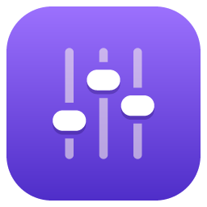
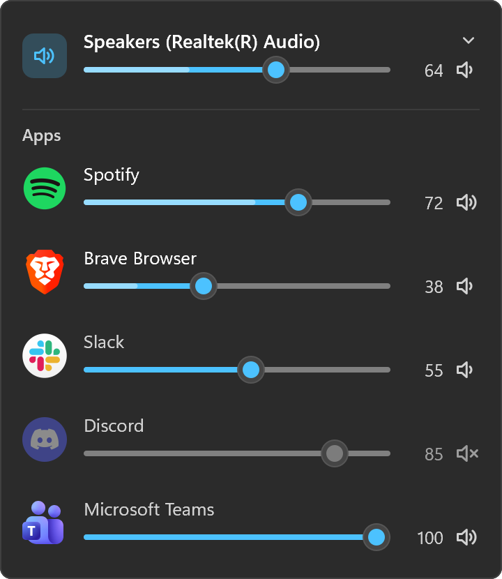
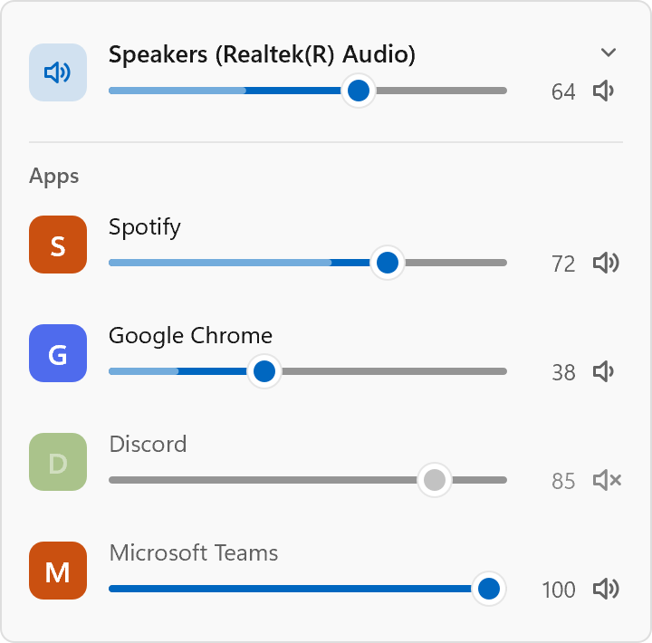

<div align="center">



# Sonus

A volume slider for every app, in the tray.<br>
For Windows, macOS and Linux.

<sub><i>sonus</i>: Latin for <i>sound</i></sub>

**[josebarbosa.dev/sonus](https://josebarbosa.dev/sonus/)**

</div>

The call is too quiet and the music is too loud. macOS has no per-app volume,
and on Windows the Volume Mixer is two clicks deep in Settings. Click Sonus in
the tray and you get a slider, a level meter and a mute button for every app
playing sound, with your output device at the top.

It's one file of about 1 MB with nothing else to install. Idle in the tray,
it uses a few MB of memory and almost no CPU.

<p align="center">


</p>

## The panel

Left-click the icon to open it. Click anywhere else or press Esc to close it.
On Linux, clicking the icon always opens the menu (that's how Linux trays
work), so open the panel with **Show mixer** at the top of the menu, or by
starting Sonus from your app launcher.

- The top row is your output device. Click its name to switch to headphones,
  speakers or a monitor.
- Below it, each app playing sound gets a row with its own icon. Apps that
  play from several processes, like Chrome or Teams, still get one row. On
  Windows, apps that have sound open but are silent show up dimmed.
- Click the track to jump to a level, or drag. The lighter band inside the
  slider shows how loud the app is right now.
- Scroll over a row to change it by 2% per notch.
- Click the speaker at the end of a row, or the app's icon, to mute it.
  Dragging a muted slider unmutes it.
- An app that's playing music or video gets a second line under its slider
  with the cover, the track, previous / play / next, and a progress bar you
  can click to jump. On Windows that works for any app that shows up in the
  media controls next to the volume flyout. On macOS it's only Spotify and
  Music, the two players that let other apps control them.

On Windows the panel looks like Windows 11's own flyouts and uses your accent
colour and the taskbar's light or dark theme. On macOS it uses the same
frosted background as the menu bar's menus. On Linux it follows your
desktop's light or dark style and accent colour, and uses its font and icons.
On X11 it opens by the pointer; on Wayland, which doesn't let apps place their
own windows, your desktop decides where it goes.

## The menu

Right-click the icon:

```
      Show mixer
      ───────────────────────────
      Output                     ▸   ✓ Speakers (Realtek(R) Audio)
      ───────────────────────────      Headphones (WH-1000XM5)
      Settings                   ▸
      Check for updates…
      ───────────────────────────
  ⏻   Quit Sonus                ⌘Q
```

Output switches the device without opening the panel. Settings has Run at
login, Edit settings file… and Open log. Check for updates… opens Sonus's
page in your browser, which compares your version with the latest release;
Sonus itself never goes online.

Starting Sonus again while it's running opens the panel, so you can also
reach it from the Start menu or Spotlight.

## From a terminal

On Windows and Linux:

```
sonus list               # the output device and every app's level
sonus set spotify 30     # set an app's volume; any part of its name works
sonus set output 50      # the device
sonus mute chrome        # or unmute
```

On macOS, app levels only exist while Sonus is running (see below), so `set`
only works with `output` there.

## Install

### Windows

```powershell
scoop bucket add kidchenko https://github.com/kidchenko/scoop-bucket
scoop install kidchenko/sonus
```

`winget install kidchenko.Sonus` and `choco install sonus` are coming: both
packages are waiting on review.

Or grab [**Sonus-Setup.exe**](https://github.com/kidchenko/sonus/releases/latest/download/Sonus-Setup.exe)
directly. Each release also ships a portable `sonus-x.y.z-x64.exe` that runs
without installing; see [Releases](https://github.com/kidchenko/sonus/releases).

The app isn't code-signed yet, so SmartScreen warns you the first time you run
it. Click **More info**, then **Run anyway**.

### macOS

```bash
brew install --cask kidchenko/tap/sonus
```

Or download [**Sonus.dmg**](https://github.com/kidchenko/sonus/releases/latest/download/Sonus.dmg)
(Apple silicon and Intel), open it, and drag Sonus into **Applications**. It
lives in the menu bar and doesn't show up in the Dock.

The app isn't notarized yet, so macOS blocks it the first time you open it.
Homebrew takes care of that for you. Otherwise, do one of these once:

- Go to **System Settings > Privacy & Security** and click **Open Anyway**
  next to Sonus.
- Run `xattr -dr com.apple.quarantine /Applications/Sonus.app`

Move it into Applications before you do this. It won't work while the app is
still inside the disk image.

The first time you change an app's volume, macOS asks whether Sonus may record
system audio. Per-app volume on macOS depends on it (see How it works). If you
say no, the panel tells you and links to the right page in System Settings.

The first time the panel shows Spotify or Music, macOS also asks whether
Sonus may control it. The play buttons need that, but the slider works
either way. You can change your answer under **System Settings > Privacy &
Security > Automation**.

### Linux

Ubuntu, Debian, Linux Mint and Pop!_OS:

```bash
wget https://github.com/kidchenko/sonus/releases/latest/download/sonus_amd64.deb
sudo apt install ./sonus_amd64.deb
```

Fedora and openSUSE:

```bash
sudo dnf install https://github.com/kidchenko/sonus/releases/latest/download/sonus.x86_64.rpm
# or
sudo zypper install https://github.com/kidchenko/sonus/releases/latest/download/sonus.x86_64.rpm
```

Anything else, Arch included: unpack
[**sonus-x86_64-linux.tar.gz**](https://github.com/kidchenko/sonus/releases/latest/download/sonus-x86_64-linux.tar.gz)
into `/usr/local` (or `~/.local`). It needs GTK 3, libpulse and
libayatana-appindicator, which on Arch are `gtk3`, `libpulse` and
`libayatana-appindicator`.

Sonus shows up in your app launcher. Start it once, then turn on **Run at
login** under Settings in its menu.

The tray icon needs a desktop that shows tray icons. KDE Plasma, Cinnamon,
XFCE, MATE, Budgie and Ubuntu's GNOME all do. Stock GNOME, as on Fedora,
needs the [AppIndicator extension](https://extensions.gnome.org/extension/615/appindicator-support/)
first. Without a tray, starting Sonus from the launcher still opens the panel.

### Requirements

Windows 10 or later. App volumes on macOS need 14.2 or later; on older
versions Sonus can still switch the output device and change its volume. On
Linux, PipeWire or PulseAudio, which every desktop distribution has, and a
distribution from 2022 or later (Ubuntu 22.04, Debian 12, Fedora 36).

## How it works

| | Apps and their levels | The device |
|---|---|---|
| Windows | WASAPI audio sessions: `IAudioSessionManager2`, `ISimpleAudioVolume`, `IAudioMeterInformation` | `IAudioEndpointVolume`; switching it uses `IPolicyConfig`, as Sound settings does |
| macOS | Core Audio process taps, and an aggregate device per app | Core Audio's device properties |
| Linux | The sound server's sink inputs, over the PulseAudio protocol (PipeWire speaks it too) | Its sinks; switching moves playing apps along |

The play buttons use the media sessions behind Windows' own media controls
(`GlobalSystemMediaTransportControlsSessionManager`), MPRIS over D-Bus on
Linux, and AppleScript on macOS, where the system's now-playing service is
private.

Windows has had per-app volume since Vista. Each app that plays sound opens an
audio session with its own volume and meter, and Sonus changes the same
settings as Windows' Volume Mixer. That's why a level you set stays after the
app or Windows restarts.

Linux has it too. Every app that plays sound has its own stream on the sound
server, with its own volume, and the server remembers each app's level, as
Windows does.

macOS has no per-app volume, so Sonus adds it. When you change an app's level,
Sonus creates a process tap for that app. The tap captures the app's sound and
mutes the original, and Sonus plays the sound to your output device at the
level you picked. Apps you haven't touched play directly, as usual.

The taps close when Sonus quits, so apps go back to full volume. Sonus saves
your levels in its config and restores them the next time each app plays
(the `remember` setting). The captured audio is never recorded and never
leaves your computer.

The panel is drawn with Direct2D and DirectWrite on Windows, AppKit on
macOS, and cairo and pango on Linux, from one layout. There's no WebView, which keeps the app under a
megabyte and quick to open.

## Configuration

`%APPDATA%\Sonus\config.json` on Windows,
`~/Library/Application Support/Sonus/config.json` on macOS,
`~/.config/sonus/config.json` on Linux. Changes apply a couple of seconds
after you save.

```json
{
  "wheelStep": 2,
  "showSystemSounds": true,
  "remember": true,
  "levels": {
    "com.spotify.client": { "volume": 0.4, "muted": false }
  }
}
```

| | |
|---|---|
| `wheelStep` | Percent per mouse wheel notch, from 1 to 25. |
| `showSystemSounds` | Windows and Linux: show the "System sounds" row, which controls notification chimes. |
| `remember` | macOS: restore each app's level when it plays again. |
| `levels` | macOS: the saved levels, by bundle id. Sonus writes these. |

The log is `sonus.log` in the same folder. Set `SONUS_LOG=debug` to log every
session Sonus finds and every level it sets.

## Build

Rust 1.77 or newer.

```powershell
.\build.ps1           # Windows: tests, release exe, installer if Inno Setup is installed
.\build.ps1 -Icons    # ... and regenerate the icons
```

```bash
./build.sh            # macOS: tests, release binary, dist/Sonus.app
./build.sh --dmg      # ... and a disk image
```

On Linux, with GTK 3, libpulse and libayatana-appindicator's development
packages (`libgtk-3-dev libpulse-dev libayatana-appindicator3-dev` on Ubuntu):

```bash
./build.sh            # Linux: tests, release binary
./build.sh --package  # ... and dist/: a .deb, an .rpm and a .tar.gz
```

No Linux machine? [packaging/linux/Dockerfile](packaging/linux/Dockerfile)
is one, with a sound server and a display to try it on.

The screenshots above come from
`sonus --render-panel target/panel.rgba --theme light --scale 2`, converted
with `python assets/panel_png.py`. They use the real icons of whichever sample
apps are installed (Spotify, Chrome or Brave, Slack, Discord, Teams).
`sonus --dump-app-icons docs/img/apps` saves those icons for the website demo,
and `sonus --preview-panel` opens the panel with sample content.

## Releasing

1. Bump `version` in `Cargo.toml` and add a section to `CHANGELOG.md`.
2. `git tag vX.Y.Z && git push origin vX.Y.Z`

The `release` workflow builds the DMG on macOS, the installer and portable exe
on Windows, and the .deb, .rpm and .tar.gz on Linux, puts them on a GitHub
Release with checksums, and updates the
Chocolatey and winget manifests with the new version and checksums:

- Chocolatey gets the new package automatically when the `CHOCO_API_KEY`
  secret is set.
- For winget, submit the `manifest-winget` artifact to
  [microsoft/winget-pkgs](https://github.com/microsoft/winget-pkgs), or use
  `wingetcreate submit`.
- Homebrew's [kidchenko/homebrew-tap](https://github.com/kidchenko/homebrew-tap)
  bumps `Casks/sonus.rb` itself: right away when the `HOMEBREW_TAP_TOKEN`
  secret is set, otherwise on its daily run.

Running the workflow by hand from the Actions tab is a dry run: it builds
everything and uploads it as artifacts without publishing anything.

## Not yet

- A different output device per app, like music on the speakers and the call
  on the headset.
- Volume above 100%.
- Lowering music automatically during a call.
- A hotkey to mute the app in front.
- On macOS, a level meter for the device and for apps you haven't changed.
  Both would mean tapping every app.

## License

MIT. The menu's general icons are from [Lucide](https://lucide.dev) (ISC); see
[assets/icons/LICENSES.md](assets/icons/LICENSES.md).
